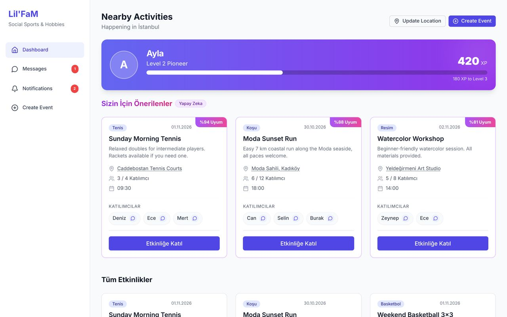
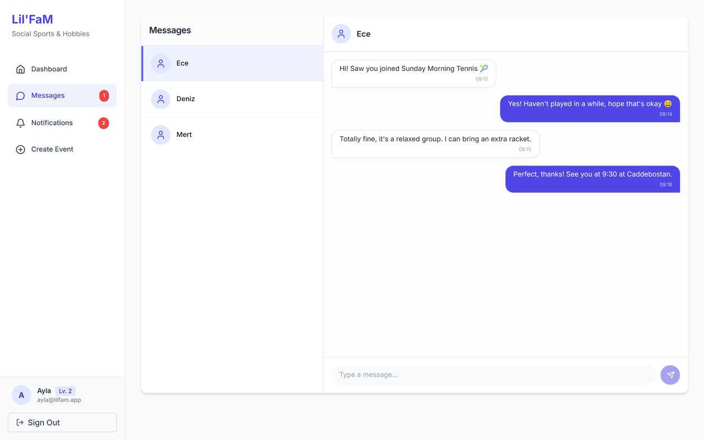
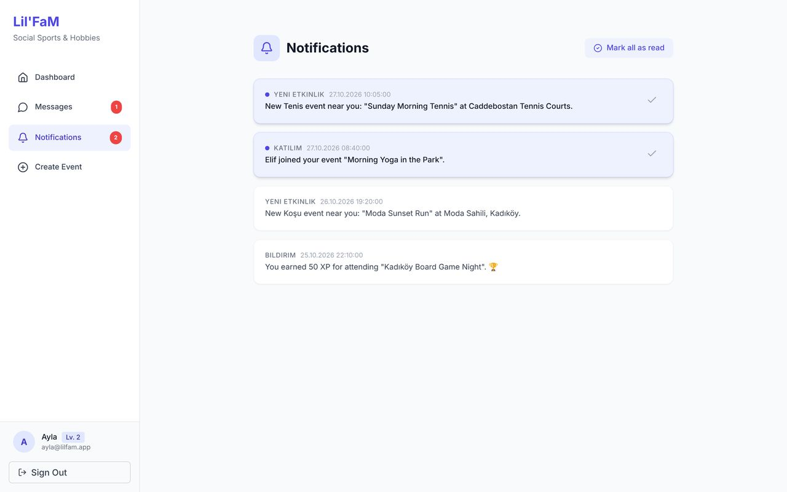
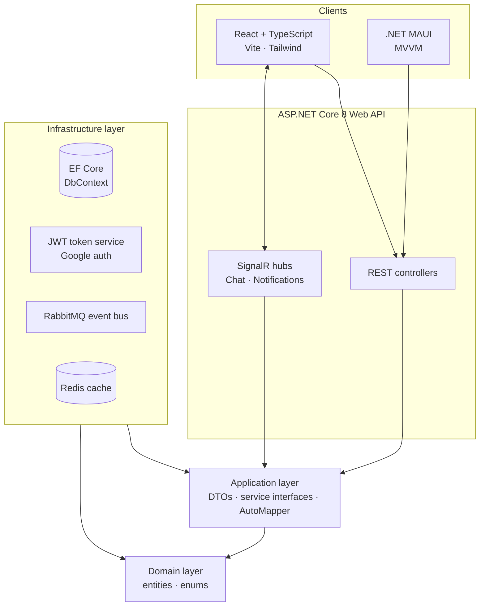

<h1 align="center">🤝 LilFam</h1>

  A location-based social platform that connects people through shared activities: sports, hobbies and arts.

  
  
  
  
  
  
  
  
  
  

> 🔒 **The source code for this project is private.** This repository is a showcase of what it does and how it's built. I'm happy to walk through the code during an interview.

---

## 💡 The Idea

Finding people to play tennis with, join a painting workshop or go hiking is harder than it should be. LilFam lets users list the activities they enjoy along with their skill level, discover nearby events and people with similar interests, and organize meetups, all in one place.

---

## 📸 Screenshots

  

| Real-time messaging | Live notifications |
|---|---|
|  |  |

Web client running with demo data.

---

## ✨ Features

- 📍 **Location-aware events:** create events with a venue, map coordinates, date, capacity and a target skill level
- 🎯 **Activity profiles:** users pick activities from categories (sport, hobby, art) and set a skill level for each
- 🤝 **Matching:** suggests people with compatible interests and a match score
- 💬 **Real-time chat:** one-to-one messaging over SignalR
- 🔔 **Live notifications:** event and profile updates pushed instantly via a SignalR notification hub
- 🏆 **Gamification:** points, levels and badges to keep users engaged
- 🔐 **Authentication:** email/password with JWT, plus Google sign-in
- 📱 **Two clients:** a React + TypeScript web app and a cross-platform .NET MAUI mobile app

---

## 🏗️ Architecture

The backend follows **Clean Architecture**, with dependencies pointing inward toward the domain.

---

## 🧠 Technical Highlights

| Area | Approach |
|---|---|
| Architecture | Clean Architecture with separate Domain, Application, Infrastructure and API projects |
| Real-time | SignalR hubs for chat and notifications, with a custom user ID provider to route messages to the right user |
| Event-driven updates | Profile changes are published to **RabbitMQ** and handled by consumers, keeping the API responsive |
| Performance | **Redis** caching layer behind an `IAppCache` abstraction |
| Security | JWT authentication with Google sign-in support |
| Mobile | .NET MAUI app built with MVVM and an authenticated HTTP handler |

---

## 🛠️ Tech Stack

- **Backend:** C#, ASP.NET Core 8 Web API, EF Core, AutoMapper
- **Real-time & messaging:** SignalR, RabbitMQ
- **Caching:** Redis
- **Auth:** JWT, Google sign-in
- **Web client:** React, TypeScript, Vite, Tailwind CSS
- **Mobile client:** .NET MAUI (MVVM)

---

## 👩‍💻 Author

**Ayla Karacı**, Senior .NET Full Stack Developer
[LinkedIn](https://www.linkedin.com/in/ayla-karaci-3a709918a/) · [Email](mailto:karaciayla@gmail.com) · [GitHub](https://github.com/AylaKaraci)
